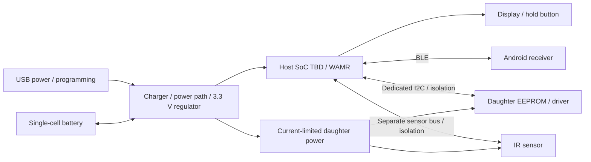

# Babel prototype architecture proposal

Status: working design, updated 2026-10-17. WAMR is the user-selected runtime;
see [runtime-decision.md](runtime-decision.md). This advances the requirements in
[architecture.md](architecture.md); remaining proposals do not imply user approval,
tested hardware, or a fabrication-ready design. Component recommendations below are
engineering judgments based on the linked primary sources. Prices, inventory,
exact footprints, and complete reference circuits have not yet been checked.

## Proposed system

The IR daughter board needs no MCU. The host reads a manifest and portable Wasm
from its EEPROM, initializes the sensor, and sends the same measurements to the
display and phone. Programming initially uses the host's wired development
connection; BLE driver upload is outside this prototype proposal.

## Working selections and alternatives

| Area | Proposed baseline | Why / tradeoff |
| --- | --- | --- |
| Host | User-selected ESP32-S3-WROOM-1-N8R8 | Radio schematic baseline; WAMR mode, timing, memory and BLE coexistence still require qualification. Alif excluded; STM32N6 not selected. |
| Driver NVM | Microchip 24LC256-I/SN EEPROM remains a candidate | Dedicated I2C and 32 KiB; capacity must be checked against compiled Wasm drivers before freezing the part. |
| Sensor | MLX90632SLD-DCB-000-RE, adapting Adafruit's breakout | User-selected direction on 2026-10-17. I2C raw data/calibration with host temperature calculations; see hardware/ir-daughter/ADAPTATION.md. |
| Connector | Guided card-edge cartridge, 20 logical contacts provisional | User-selected mechanism; socket, contact geometry, and plating remain open. |
| Power | One protected Li-ion/Li-poly cell, power-path charger, 3.3 V buck-boost, independently switched daughter rail | Host and sensor stay regulated over battery discharge; sensor faults have a controlled power path. |
| Display | Small SPI display, numerical readout, one hold button | Provisional UI; keeps both I2C controllers available for separate daughter buses. Exact display remains open. |
| Execution | WAMR with a versioned Babel host API | Portable driver artifact; execution mode, host OS, and timing guarantees still require qualification. |

### Host rationale

The WROOM-1 N8R8 variant has 8 MB flash and 8 MB octal PSRAM. It remains a
candidate, but the earlier selection based on MicroPython support is superseded.
Compare hosts using the chosen WAMR configuration, actual driver memory use,
timing requirements, BLE integration, power, and cost. No host OS is selected.
[Espressif module datasheet](https://www.espressif.com/sites/default/files/documentation/esp32-s3-wroom-1_wroom-1u_datasheet_en.pdf).

Allocate separate hardware I2C controllers to EEPROM and sensor, one SPI
controller to the display, and another to daughter SPI when needed. Verify the
selected host's peripheral mapping, USB pins, strapping pins, memory-pin
restrictions, and debugging access before assigning GPIO numbers. This peripheral
allocation is a design target, subject to the selected host's capabilities.

### Memory and sensor rationale

The 24LC256 supports 2.5–5.5 V operation, 64-byte write pages, up to 400 kHz I2C,
and a maximum 5 ms write cycle. Use 100 kHz for initial discovery and bounded ACK
polling after writes. A0–A2 are grounded for address 0x50. A dedicated WP signal
defaults to write-protected. These choices also define the fixed access method
for blank boards.
[Microchip EEPROM datasheet](https://ww1.microchip.com/downloads/aemDocuments/documents/MPD/ProductDocuments/DataSheets/24AA256-24LC256-24FC256-256K-I2C-Serial-EEPROM-DS20001203.pdf).

SPI NOR would offer more storage but needs more NVM signals and an erase/update
scheme. FRAM is worth revisiting for frequent persistent writes; this prototype
stores infrequently updated Wasm binaries and does not log measurements in driver NVM.
EEPROM is a proposed interpretation of the source document's general NVM
requirement, rather than a literal flash selection.

The initial MLX90614 choice is superseded by an adaptation of Adafruit's
MLX90632 breakout. Use its DCB 3.3 V I/O variant and sensor circuit, with Babel's
regulated supply, card edge, and separate driver EEPROM. Address is 0x3A;
temperature calculation runs on the host. Review provenance, differences, and
the archived revision A in [the adaptation notes](hardware/ir-daughter/ADAPTATION.md).

Provisional demonstration: display object and ambient temperature twice per
second, with a large matte target a few centimetres away. This is an application
target, not a validated range/accuracy claim. Keep the sensor away from the
regulator and host heat, and leave its optical aperture unobstructed. Final target
distance follows the selected part's field of view.

## Connector and electrical contract

Use 3.3 V logic only. No raw battery or USB voltage appears on the daughter port.
Initial allocation: 100 mA maximum continuous daughter load, including NVM and
any MCU. The rail's current-limit setting must allow that load at worst-case
tolerance while protecting host regulation. Components, inrush capacitance,
signal timing, and power tolerances still need calculation.

The following are logical contact IDs, not physical connector pin numbers. The
physical order must account for grounds, routing, contact sequence, and keying.

| ID | Signal | Direction relative to host / rule |
| --- | --- | --- |
| 1–2 | GND | Two ground contacts |
| 3–4 | VDD_DAUGHTER | Switched 3.3 V; two contacts on the same rail |
| 5 | NVM_SCL | Host clock, open drain |
| 6 | NVM_SDA | Bidirectional, open drain |
| 7 | NVM_WP | Host open-drain control; daughter pull-up protects by default |
| 8 | PRESENT_N | Passive daughter connection to ground; host senses presence |
| 9 | SENSOR_SCL | I2C/SMBus only |
| 10 | SENSOR_SDA | I2C/SMBus only |
| 11 | SENSOR_SCK | SPI clock from host |
| 12 | SENSOR_MOSI | SPI data from host |
| 13 | SENSOR_MISO | SPI data to host |
| 14 | SENSOR_CS_N | SPI select; inactive pull-up on daughter |
| 15 | SENSOR_TX | UART host TX to daughter RX |
| 16 | SENSOR_RX | UART host RX from daughter TX |
| 17 | SENSOR_IRQ_N | Optional open-drain event from daughter |
| 18 | SENSOR_RESET_N | Optional open-drain reset from host |
| 19–20 | GND | Additional return contacts |

Dedicated sensor pins avoid multiplexing ambiguity at the cost of connector size.
Only the declared bus is enabled. Unused daughter contacts remain unconnected;
all unused host signal paths are isolated. This revision does not promise analog
inputs, CAN, UART flow control, or arbitrary MCU debug through the connector.
Optional MCU firmware programming may use daughter test pads; the connector
programming requirement is met for host-executed driver NVM.

Specify host-side and connector-side pull-ups around isolation deliberately;
connector-side pull-ups reference the switched rail. Do not accidentally power
an unpowered board through WP, CS, reset, data, or bus pull-ups.

### Mechanical shortlist and hot-swap constraints

The user selected a guided card-edge interface, consistent with their earlier
working prototype. The exact socket, board thickness, contact geometry, retention,
and insertion/removal sequencing remain to be selected before layout. J1 currently
defines logical connections, not a fabrication-ready edge footprint.

TFM/SFM and spring-contact cartridges were earlier alternatives, not the current
direction. Validate mating force, wear, contact order, and availability for the
selected card-edge socket; the connector choice alone does not establish safe
hot swapping.

The main board must have:

- Daughter power disabled at reset and when absent, with current limiting.
- Signal isolation disabled by default, independent of driver execution.
- Hardware-assisted removal disable where practical. A normal equal-length
  PRESENT contact alone does not guarantee early removal detection.
- An electrical/mechanical solution for arbitrary partial insertion and removal;
  a software debounce delay cannot establish contact order.
- A bounded recovery path if a removed sensor holds or interrupts a transaction.

TCA4307 is a candidate for dedicated I2C buffering and stuck-bus recovery;
SN74CB3Q3245 is a candidate for grouped signal disconnection. Neither is selected
without checking voltage thresholds, pull-ups, powered-off behavior, direction
requirements, and the full partial-mating circuit.
[TI TCA4307](https://www.ti.com/product/TCA4307),
[TI SN74CB3Q3245](https://www.ti.com/product/SN74CB3Q3245).

## Power proposal and sizing

Candidate chain: USB 5 V → BQ24074 power path → TPS63070 set to 3.3 V → host and
display, plus a TPS2553-controlled daughter branch. The battery connects to the
charger battery port, not directly to the 3.3 V rail. TI documents single-cell
charging/power-path support, buck-boost regulation, and adjustable load-current
limiting respectively.
[BQ24074](https://www.ti.com/product/BQ24074),
[TPS63070](https://www.ti.com/product/TPS63070),
[TPS2553](https://www.ti.com/product/TPS2553).

Start with a 1,000 mAh battery sizing assumption and this deliberately provisional
3.3 V load budget:

| Load | Average allocation |
| --- | ---: |
| Host / BLE / WAMR (unmeasured allocation) | 100 mA |
| Display | 30 mA |
| IR daughter including EEPROM | 10 mA |
| Margin and supporting circuits | 20 mA |
| Total | 160 mA / 0.528 W |

Using 3.7 Wh nominal battery energy, 80% usable energy, and 85% conversion
efficiency gives about 4.8 hours at that allocation, or 2.5 hours at 300 mA on
the 3.3 V rail. This is a sensitivity estimate, not measured runtime. Check radio
peaks and daughter inrush separately; target at least 1 A regulator output
capability over the chosen battery operating range, subject to thermal analysis.

Before schematic release, choose the cell and its protection/temperature sensing,
charge and USB input limits, USB-C sink/data implementation, regulator passives,
and off-state behavior. Check charger dissipation with simultaneous charging and
operation. The charger is not a substitute for battery protection.

## Execution model and next work

Use the [draft board/software contract](board-contract-v0.md) for the first loader
and Android receiver. Host services own display, BLE, bus handles, power, and
attachment state. Drivers must return promptly and never run a permanent loop.

Use bounded module memory, validated host calls, and an execution-budget strategy
appropriate to the selected WAMR mode. Native calls also need bounded completion
and cancellation. Establish timing bounds on each host revision; neither Wasm
portability nor instruction metering alone establishes a wall-clock guarantee.
A watchdog reset is a last-resort crash recovery, not successful hot swapping.
See [runtime-decision.md](runtime-decision.md) for the qualification plan.

Immediate implementation sequence:

1. Pin a WAMR version and build a portable C-to-Wasm driver experiment with a
   narrow Babel API. Measure image/RAM size and exercise traps, loops, and
   interrupted host calls before freezing NVM or selecting a SoC. Then implement
   the image packer/validator and BLE codec against the revised contract.
2. Implement EEPROM access, lifecycle handling, and the IR driver on development
   hardware; verify I2C timing and removal behavior with instruments.
3. Resolve connector contact sequencing, signal isolation, exact sensor/display
   parts, and GPIO allocation. Complete the power circuit calculations.
4. Produce KiCad schematics and review ERC, footprints, reference circuits, and
   mechanical placement before layout or fabrication.
5. Integrate Android reception and measure reconnect, swaps, and battery life.

Native KiCad schematic drafts now exist for the
[IR daughter](hardware/ir-daughter/README.md) and
[WROOM radio/main board](hardware/radio/README.md). Neither is routed or released
for fabrication. The radio README records its provisional display connection,
charge-disabled default assembly, USB startup constraints, and grouped sensor
isolation limitation relative to the proposal above. Firmware and app remain
unimplemented. Hardware testing requires actual boards and measurement equipment.
No parts have been ordered or boards fabricated.
